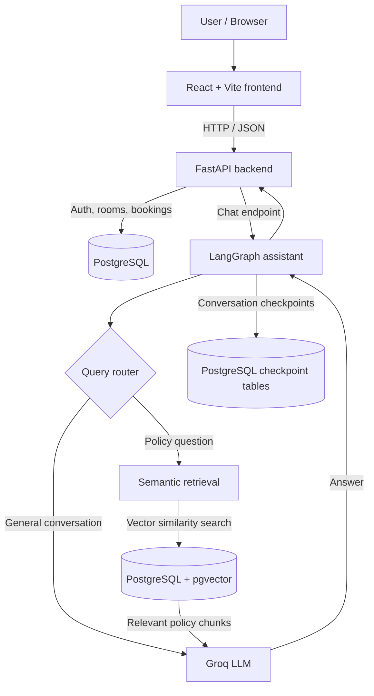

<div align="center">

# 🏢 Roomly

### Book better spaces. Get smarter answers.

**A full-stack meeting-room reservation platform with a built-in, policy-aware AI assistant.**

Discover rooms, check availability, manage reservations, and ask questions about booking policies—all in one place.

<br />


<br />

[**Features**](#-what-roomly-can-do) · [**Architecture**](#-system-architecture) · [**AI Pipeline**](#-how-the-ai-assistant-works) · [**Local Setup**](#-run-it-locally) · [**Project Structure**](#-project-structure)

</div>

---

## ✨ The idea

Roomly is a practical **full-stack + AI engineering project** built around a familiar business workflow: reserving shared spaces. Instead of building an AI chatbot in isolation, Roomly embeds one into a functioning product.

The application has **two connected experiences**:

- **Room booking:** browse available rooms, inspect details, choose a time slot, create a reservation, and cancel it when needed.
- **AI assistance:** ask about company policies, cancellations, refunds, and facilities through a conversational assistant powered by **LangGraph**, **Groq**, and **retrieval-augmented generation (RAG)**.

The focus is on the integration: **React → FastAPI → PostgreSQL**, plus a policy-aware AI workflow that uses the same application backend.

## 🚀 What Roomly can do

<table>
  <tr>
    <td width="50%" valign="top">
      <h3>🗓️ Room reservations</h3>
      <ul>
        <li>Browse rooms and view capacity, descriptions, and hourly rates</li>
        <li>Check availability for a selected date and time</li>
        <li>Book a room using an authenticated account</li>
        <li>See your own booking history</li>
        <li>Cancel eligible future reservations</li>
      </ul>
    </td>
    <td width="50%" valign="top">
      <h3>🤖 AI-powered help</h3>
      <ul>
        <li>Floating chatbot integrated into the website</li>
        <li>LangGraph routing for general chat vs. policy questions</li>
        <li>Relevant policy retrieval with semantic vector search</li>
        <li>Responses grounded in company policy PDFs</li>
        <li>Multiple conversations and persistent chat state</li>
      </ul>
    </td>
  </tr>
  <tr>
    <td valign="top">
      <h3>🔐 Accounts & data</h3>
      <ul>
        <li>Registration and login</li>
        <li>JWT-protected booking endpoints</li>
        <li>User-specific booking history</li>
        <li>PostgreSQL data persistence and Alembic migrations</li>
      </ul>
    </td>
    <td valign="top">
      <h3>🎨 Product experience</h3>
      <ul>
        <li>Responsive React interface</li>
        <li>Room detail and booking views</li>
        <li>Conversation switching and a new-chat flow</li>
        <li>Formatted AI responses and source display</li>
      </ul>
    </td>
  </tr>
</table>

## 📸 Screenshots

> **Add screenshots of your actual application before publishing.** Suggested captures: home / room listing, room details with availability, My Bookings, and the AI chatbot answering a policy question.

<!--
Create a `screenshots/` directory in the repository, then uncomment these:

| Room discovery | Room booking |
|:---:|:---:|
|  |  |

| My Bookings | AI assistant |
|:---:|:---:|
|  |  |
-->

## 🧱 System architecture



> **Design choice:** The demo uses **one PostgreSQL database** for operational data, policy embeddings, and LangGraph checkpoints, separated logically by tables. This keeps the architecture simple for a compact application while leaving room to split AI storage and business storage later.

## 🧠 How the AI assistant works

### 1. Index the company policies

```text
Policy PDFs
   ↓ extract text
Text chunks
   ↓ embed locally
sentence-transformers/all-MiniLM-L6-v2
   ↓ 384-dimensional vectors
PostgreSQL + pgvector
```

Roomly uses the free **[all-MiniLM-L6-v2](https://huggingface.co/sentence-transformers/all-MiniLM-L6-v2)** embedding model from Hugging Face. Embeddings are generated locally—no paid embedding API is required.

### 2. Route each user question

LangGraph decides which path to follow:

| Path | Example | Behavior |
|---|---|---|
| **Direct** | “Hello! What can you help with?” | The LLM responds without policy retrieval. |
| **RAG** | “What is the cancellation policy?” | Retrieve relevant policy chunks, then generate a grounded answer. |

### 3. Remember conversations

Conversation state is stored using **LangGraph's PostgreSQL checkpointer**. A user-scoped thread identifier keeps saved chat threads associated with their authenticated user. The frontend also provides a conversation selector.

**Important boundary:** The policy chatbot does not directly update bookings or execute arbitrary SQL. Actual booking changes go through the application's authenticated API endpoints.

## 🛠️ Tech stack

| Layer | Technology | Responsibility |
|---|---|---|
| Frontend | React, Vite, React Router | Pages, forms, navigation, chatbot UI |
| Backend | Python, FastAPI, Pydantic | REST APIs and business logic |
| Database | PostgreSQL, SQLAlchemy, Alembic | Accounts, rooms, reservations, migrations |
| Vector search | pgvector | Semantic retrieval of policy chunks |
| AI workflow | LangGraph | Query routing and conversation orchestration |
| LLM inference | Groq API | Generating assistant responses |
| Embeddings | Hugging Face / Sentence Transformers | Local text embeddings (`384` dimensions) |
| PDF ingestion | pypdf | Extracting content from policy documents |
| State persistence | LangGraph PostgreSQL saver | Conversation checkpoints |
| Local database | Docker Compose | Reproducible PostgreSQL environment |

## 📁 Project structure

```text
roomly/
├── backend/
│   ├── app/
│   │   ├── ai/
│   │   │   ├── graph.py         # LangGraph router + nodes
│   │   │   └── rag.py           # PDF ingestion + retrieval
│   │   ├── main.py              # FastAPI endpoints
│   │   ├── database.py          # Database connection
│   │   ├── models.py            # SQLAlchemy models
│   │   ├── schemas.py           # Request / response models
│   │   └── security.py          # Authentication utilities
│   ├── alembic/                 # Database migrations
│   ├── alembic.ini
│   └── requirements.txt         # Python dependencies
├── frontend/
│   ├── src/
│   │   ├── components/
│   │   │   ├── ChatWidget.jsx
│   │   │   ├── ChatWidget.css
│   │   │   ├── RoomCard.jsx
│   │   │   └── RoomDetails.jsx
│   │   ├── App.jsx
│   │   └── api.js
│   ├── package.json
│   └── package-lock.json
├── policies/
│   ├── booking_policy.pdf
│   ├── cancellation_refund_policy.pdf
│   └── facilities_usage_policy.pdf
├── docker-compose.yml
├── .env.example
├── .gitignore
└── README.md
```

<sub>Illustrative structure; retain any additional source files generated by Vite or your backend.</sub>

## ⚙️ Run it locally

### Prerequisites

- **Python** and **Node.js** / npm
- **Docker Desktop** with Docker Compose
- A **Groq API key** for the chatbot

### 1. Clone the repository

```bash
git clone https://github.com/YOUR_USERNAME/roomly.git
cd roomly
```

> Replace `YOUR_USERNAME` with your GitHub username after creating the repository. You can also download the repository as a ZIP.

### 2. Set up environment variables

Create a root `.env` file based on `.env.example`. The application needs values such as:

```dotenv
# Match these values to your docker-compose.yml and backend configuration
POSTGRES_USER=roomly
POSTGRES_PASSWORD=change_this_locally
POSTGRES_DB=roomly_db

# Authentication — use a long, random secret
JWT_SECRET_KEY=replace_with_a_secure_random_value

# Groq inference
GROQ_API_KEY=your_groq_api_key
GROQ_MODEL=openai/gpt-oss-20b
```

Your backend's database configuration must match the database credentials and exposed port in `docker-compose.yml` (the local Roomly setup uses port **5433** for PostgreSQL).

**Never commit `.env`, API keys, tokens, or real credentials.** Only commit safe placeholder values in `.env.example`.

### 3. Start PostgreSQL

From the repository root:

```bash
docker compose up -d
```

### 4. Start the FastAPI backend

On **Windows PowerShell**:

```powershell
cd backend
py -m venv .venv
.\.venv\Scripts\Activate.ps1
python -m pip install -r requirements.txt
alembic upgrade head
```

> If `requirements.txt` does not exist yet, generate it from your working backend environment before uploading the repository: `python -m pip freeze > requirements.txt`.

Initialize the LangGraph checkpoint tables and index the example policy PDFs:

```powershell
python -m app.ai.graph
python -m app.ai.rag ingest
```

Run the API:

```powershell
python -m uvicorn app.main:app --reload
```

**API documentation:** [http://127.0.0.1:8000/docs](http://127.0.0.1:8000/docs)

### 5. Start the React frontend

In a **second terminal**:

```powershell
cd frontend
npm install
npm run dev
```

**App:** [http://localhost:5173](http://localhost:5173)

### 6. Try the end-to-end flow

1. Register or sign in.
2. Open a room and check an available time slot.
3. Make a booking; verify it appears in **My Bookings**.
4. Cancel an eligible reservation.
5. Open **Roomly AI** and ask, “What is the cancellation policy?”
6. Start another chat and switch back to a saved conversation.

## 🔌 Selected API endpoints

| Method | Endpoint | Purpose |
|---|---|---|
| `GET` | `/api/rooms` | List rooms |
| `GET` | `/api/rooms/{room_id}` | Get a room |
| `GET` | `/api/rooms/{room_id}/availability` | Check a proposed time slot |
| `POST` | `/api/auth/register` | Register |
| `POST` | `/api/auth/login` | Log in |
| `GET` | `/api/auth/me` | Get the current user |
| `POST` | `/api/bookings` | Create a reservation |
| `GET` | `/api/bookings/me` | View your reservations |
| `PATCH` | `/api/bookings/{booking_id}/cancel` | Cancel a reservation |
| `POST` | `/api/ai/chat` | Send a message to LangGraph |
| `GET` | `/api/ai/conversations/{conversation_id}` | Load a conversation |

See Swagger for complete request bodies, authentication requirements, and response schemas.

## 🔒 Security and engineering notes

- The backend validates JWTs for protected booking and chatbot operations.
- Passwords are hashed; plaintext passwords are not stored in PostgreSQL.
- Booking availability must be checked again when creating a booking, not only when enabling the frontend button.
- Treat retrieved PDF content as **untrusted data**, not executable instructions.
- Align policy-document room facts with the operational database before production use; the demo's policy descriptions may differ from live sample-room details.
- The local demo is **not** a claim of production-level hardening. Before a public deployment, revisit session storage, rate limiting, monitoring, validation, CORS, database permissions, and concurrency testing.

## 🧭 Next improvements

- [ ] Add automated backend and frontend tests
- [ ] Confirm booking conflict protection under concurrent requests
- [ ] Keep AI policy data synchronized with room information
- [ ] Add a cross-device conversation list and stronger session management
- [ ] Configure secure production hosting and observability
- [ ] Add real project screenshots and a public demo link

## 💡 What this project demonstrates

**Roomly is more than a standalone chatbot.** It combines a transactional application with an AI component, demonstrating backend API design, relational data modeling, authentication, React state management, semantic search, LangGraph routing, and persistent conversation state in a coherent product.

---

<div align="center">

### Built as a full-stack AI engineering portfolio project ✨

**React × FastAPI × PostgreSQL × LangGraph × Groq**

<sub>Roomly is a demo project. Policy documents and room listings are sample data.</sub>

</div>

