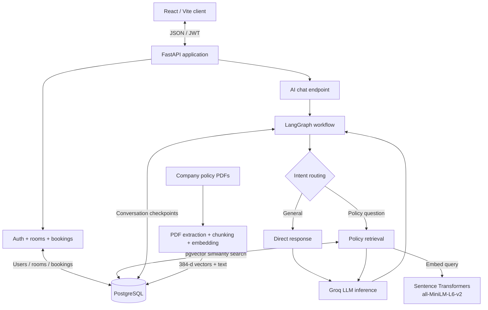

<div align="center">

# ROOMLY

### Intelligent workspace reservations, built end to end.

**A full-stack room booking platform with a policy-aware, conversation-persistent AI assistant.**

Roomly combines a transactional reservation system with a routed retrieval-augmented generation (RAG) workflow. Users can discover spaces, reserve time slots, manage bookings, and ask questions about company policies without leaving the application.

<br>

[](https://react.dev/)
[](https://fastapi.tiangolo.com/)
[](https://www.postgresql.org/)
[](https://docs.langchain.com/oss/python/langgraph/overview)
[](https://groq.com/)

<br>

[**Architecture**](#architecture) · [**Capabilities**](#capabilities) · [**AI design**](#ai-assistant-design) · [**Getting started**](#getting-started) · [**API**](#api-surface) · [**Engineering notes**](#engineering-decisions)

</div>

---

## Overview

Roomly is a **full-stack application first, with AI integrated as a product capability**—not a standalone chat demo. The booking system handles accounts, room inventory, availability checks, and reservation lifecycle operations. A separate AI workflow within the same FastAPI backend answers questions using company policy documents and maintains multi-turn context.

The codebase demonstrates the integration of **React, FastAPI, relational data modeling, authenticated REST APIs, PostgreSQL vector search, LangGraph orchestration, and LLM inference** within one cohesive application.

| Application layer | Responsibilities |
|:--|:--|
| **Client** | Responsive React interface, authentication screens, room discovery, booking forms, booking history, and floating AI chat |
| **Business API** | FastAPI endpoints, validation, JWT authentication, availability checks, booking creation and cancellation |
| **Relational persistence** | PostgreSQL tables for users, rooms, and bookings; schema changes tracked by Alembic |
| **AI runtime** | LangGraph query router, direct-answer and RAG branches, Groq-hosted LLM inference |
| **Knowledge retrieval** | Policy PDF ingestion, local Hugging Face embeddings, pgvector cosine-similarity search |
| **Conversation state** | PostgreSQL-backed LangGraph checkpoints with user-scoped conversation threads |

## Capabilities

<table>
  <tr>
    <td width="50%" valign="top">
      <strong>Booking experience</strong>
      <ul>
        <li>Browse spaces with capacity, amenities/description, and hourly pricing.</li>
        <li>Open detailed room pages and select a booking interval.</li>
        <li>Check the selected interval for availability.</li>
        <li>Create authenticated reservations.</li>
        <li>Review personal booking history and cancel eligible future bookings.</li>
      </ul>
    </td>
    <td width="50%" valign="top">
      <strong>AI-powered assistance</strong>
      <ul>
        <li>Embedded, floating chat interface—not a separate application.</li>
        <li>LangGraph routing between direct responses and document-grounded RAG.</li>
        <li>Semantic retrieval over Roomly policy PDFs.</li>
        <li>Source-aware policy answers and formatted chat messages.</li>
        <li>Multiple conversations with persistent server-side message state.</li>
      </ul>
    </td>
  </tr>
  <tr>
    <td valign="top">
      <strong>Accounts and authorization</strong>
      <ul>
        <li>Registration and login with hashed passwords and JWTs.</li>
        <li>Protected booking and chat endpoints.</li>
        <li>Current-user-scoped booking history.</li>
      </ul>
    </td>
    <td valign="top">
      <strong>Developer experience</strong>
      <ul>
        <li>OpenAPI / Swagger documentation generated by FastAPI.</li>
        <li>Alembic database migrations.</li>
        <li>Docker Compose for the local PostgreSQL instance.</li>
        <li>Separate frontend and backend dependency manifests.</li>
      </ul>
    </td>
  </tr>
</table>

## Architecture



**One PostgreSQL instance, three logical data domains.** Business data, policy vectors, and LangGraph checkpoints share infrastructure while remaining separate at the table level. This simplifies local development without coupling the user-facing booking UI to AI implementation details.

### Booking request lifecycle

1. React sends a proposed room ID and start/end timestamps to FastAPI.
2. The API evaluates availability against existing reservations.
3. An authenticated booking request is validated again on the server before creating a reservation.
4. The new record is persisted in PostgreSQL and returned through the booking API.
5. The client loads the user's personal reservations through `/api/bookings/me`.

The availability check is a user-experience feature, **not a substitute for server-side conflict prevention**. Concurrency guarantees depend on the deployed database constraints and should be verified before production use.

## AI assistant design

The assistant uses **LangGraph for control flow**, **Groq for text generation**, and **PostgreSQL with pgvector for retrieval and checkpoint persistence**.

### 1 — Document indexing

```text
Policy PDFs
    │
    ▼
Text extraction (pypdf)
    │
    ▼
Overlapping text chunks
    │
    ▼
Local sentence-transformers/all-MiniLM-L6-v2
    │
    ▼
384-dimensional embeddings
    │
    ▼
PostgreSQL policy_documents + policy_chunks (pgvector)
```

The embedding model runs locally; **no paid embedding endpoint is required**. Policy content can be re-ingested from the repository's sample PDFs.

### 2 — Conditional answer generation

| LangGraph path | Trigger | Execution |
|:--|:--|:--|
| **Direct** | Greetings or general website guidance | Generate a concise answer without policy retrieval. |
| **RAG** | Policies, cancellations, refunds, or facility-use questions | Retrieve relevant policy chunks by vector similarity, then provide them as context to the LLM. |

Retrieved passages are treated as **reference data, not instructions**. The system prompts the model to avoid unsupported policy claims and to identify relevant document filenames; factual accuracy still requires evaluation.

### 3 — Multi-turn persistence

LangGraph checkpoints persist the conversation state in PostgreSQL. The backend derives a thread identifier using the authenticated user ID and a conversation UUID, allowing distinct saved discussions per account. The current web UI keeps a **local browser index of conversation IDs** and loads message history from the API.

The AI assistant is informational: **it does not execute unrestricted SQL or create/cancel reservations**. Booking changes remain behind the authenticated business endpoints.

## Technology

| Area | Stack |
|:--|:--|
| **Frontend** | React, JavaScript, Vite, React Router, CSS, Lucide React, React Markdown |
| **Backend** | Python, FastAPI, Pydantic, SQLAlchemy |
| **Authentication** | JWT, Argon2 password hashing |
| **Database** | PostgreSQL, Alembic, Docker Compose |
| **AI orchestration** | LangGraph, LangGraph PostgreSQL Checkpointer |
| **Inference** | Groq API |
| **Embeddings** | Sentence Transformers: [`all-MiniLM-L6-v2`](https://huggingface.co/sentence-transformers/all-MiniLM-L6-v2) |
| **Retrieval** | pgvector cosine-distance search |
| **Document processing** | pypdf |

## Repository structure

```text
roomly/
├── backend/
│   ├── app/
│   │   ├── ai/
│   │   │   ├── graph.py           # LangGraph router, generation, checkpoints
│   │   │   └── rag.py             # PDF ingestion, embeddings, vector search
│   │   ├── main.py                # REST API and chat endpoints
│   │   ├── database.py            # SQLAlchemy connection/session
│   │   ├── models.py              # Operational database models
│   │   ├── schemas.py             # Data validation / response contracts
│   │   └── security.py            # Password hashing / JWT utilities
│   ├── alembic/                   # Versioned database migrations
│   ├── alembic.ini
│   └── requirements.txt
├── frontend/
│   ├── public/                     # Public assets
│   ├── src/
│   │   ├── components/            # Room views and AI chat widget
│   │   ├── api.js                 # Authenticated API client
│   │   ├── App.jsx                # Application routes and pages
│   │   ├── App.css
│   │   └── index.css
│   ├── package.json
│   ├── package-lock.json
│   └── vite.config.js
├── database/
│   └── init/                       # PostgreSQL extension setup
├── policies/                        # Sample booking, refund and usage PDFs
├── docker-compose.yml
├── .env.example
├── .gitignore
├── LICENSE
└── README.md
```

## Getting started

The application runs locally as **three services**: PostgreSQL in Docker, FastAPI, and the React/Vite frontend. The steps below describe the Windows PowerShell development environment used for this project.

### Prerequisites

- Python 3.13 (development environment)
- Node.js 24 and npm (development environment)
- Docker Desktop with Docker Compose
- A [Groq API key](https://console.groq.com/keys)

### 1. Get the source and configure secrets

```powershell
git clone https://github.com/rafiunshoron/roomly.git
cd roomly
Copy-Item .env.example .env
```

Set the database configuration, a strong JWT signing secret, and your Groq key in the root `.env`. Refer to `.env.example`, `docker-compose.yml`, and `backend/app/database.py` for the expected variable names. Relevant settings include:

```dotenv
POSTGRES_USER=roomly
POSTGRES_PASSWORD=your_local_database_password
POSTGRES_DB=roomly_db
JWT_SECRET_KEY=your_long_random_signing_secret
GROQ_API_KEY=your_groq_api_key
GROQ_MODEL=openai/gpt-oss-20b
```

The sample values are illustrative—**make sure your `.env`, Compose configuration, and backend connection settings agree**. Do not commit your actual `.env`. The local database is exposed on host port **5433**.

### 2. Start PostgreSQL

From the repository root:

```powershell
docker compose up -d
```

The database must be accepting connections before applying migrations or loading knowledge documents.

### 3. Install and initialize the backend

```powershell
cd backend
py -3.13 -m venv .venv
.\.venv\Scripts\Activate.ps1
python -m pip install -r requirements.txt
alembic upgrade head
```

Initialize persistent LangGraph checkpoint tables and index the three example policy PDFs:

```powershell
python -m app.ai.graph
python -m app.ai.rag ingest
```

Start the API:

```powershell
python -m uvicorn app.main:app --reload
```

The API and its interactive Swagger documentation are now available **locally** at `http://127.0.0.1:8000` and `http://127.0.0.1:8000/docs`.

> **Sample data:** The room records used in the development demo were inserted into the local database. Schema migrations do not necessarily insert demonstration rooms into a fresh database. Seed the `rooms` table with your own test inventory if the room listing is initially empty.

### 4. Start the frontend

Open another terminal from the repository root:

```powershell
cd frontend
npm ci
npm run dev
```

Visit `http://localhost:5173` **on your own machine**. This is a development address, **not a public hosted demo**.

### 5. Verify the full workflow

| Scenario | Expected behavior |
|:--|:--|
| Registration and login | New user can authenticate and receive a JWT. |
| Room discovery | Rooms and their rates load from the API. |
| Availability and booking | A valid future slot can be checked and booked. |
| My Bookings | Authenticated user sees their reservations. |
| Cancellation | Eligible reservation changes to cancelled; slot becomes available again. |
| Direct AI route | A greeting receives an assistant response without document retrieval. |
| Policy RAG route | A policy question retrieves relevant document excerpts. |
| Conversation recovery | Revisiting a stored chat loads checkpointed history. |

## API surface

FastAPI generates the complete interactive OpenAPI specification. The routes below summarize the primary application contracts.

| Method | Route | Responsibility | Authentication |
|:--|:--|:--|:--:|
| `POST` | `/api/auth/register` | Create account | No |
| `POST` | `/api/auth/login` | Authenticate and issue JWT | No |
| `GET` | `/api/auth/me` | Retrieve current user | Yes |
| `GET` | `/api/rooms` | List rooms | No |
| `GET` | `/api/rooms/{room_id}` | Retrieve room details | No |
| `GET` | `/api/rooms/{room_id}/availability` | Check interval availability | No |
| `POST` | `/api/bookings` | Create reservation | Yes |
| `GET` | `/api/bookings/me` | Retrieve personal reservations | Yes |
| `PATCH` | `/api/bookings/{booking_id}/cancel` | Cancel an eligible reservation | Yes |
| `POST` | `/api/ai/chat` | Invoke LangGraph assistant | Yes |
| `GET` | `/api/ai/conversations/{conversation_id}` | Restore conversation messages | Yes |

**Chat request shape:**

```json
{
  "message": "What is Roomly's cancellation policy?",
  "conversation_id": null
}
```

Authenticated requests use the standard `Authorization: Bearer <JWT>` header. The API responds with the generated answer, selected route, available source filenames, and a conversation UUID that can be reused for follow-up messages.

## Engineering decisions

### Separation of concerns

The client does not talk directly to PostgreSQL or the LLM provider. FastAPI provides the boundary for business logic, authentication, and AI calls. The LangGraph workflow lives under `backend/app/ai/` and can evolve independently of the room-booking UI.

### Shared database, distinct workloads

Operational records, embedding vectors, and checkpoints share the same PostgreSQL database for development simplicity. At larger scale, these workloads could move to separate databases or services to isolate latency, permissions, scaling, and maintenance responsibilities.

### Policy knowledge versus operational truth

Policy PDFs are suitable sources for *rules and guidance*, while **room capacity, rates, booking status, and availability belong to the operational database**. The sample policy documents and room data must remain synchronized. A test chatbot response gave a different capacity for Workspace C than the room listing; the cause (retrieved content versus generation) needs to be investigated before external release.

### Security posture

- Passwords are hashed with Argon2; authenticated actions use JWT-based API access.
- The chat API scopes persisted thread IDs to the authenticated user.
- Embedding documents do not grant permission to read or modify operational records.
- Development credentials must live outside version control.
- The current client stores JWTs in browser session storage and keeps its conversation index in local storage. These are pragmatic demo choices, **not a claim of production-grade session security**.

## Validation and current scope

**Verified during local development:** room listing, registration/login, reservation creation, cancellation, chatbot interaction, and a successful Vite production build (`npm run build`).

**Not yet established:** a public deployment, comprehensive automated tests, load and concurrency testing, fully synchronized policy data, and production security hardening. This repository is a **working portfolio application**, not a production-operated booking service.

The most meaningful next improvements are automated API/UI tests, reproducible room seeding, concurrent booking-conflict tests, policy-data synchronization, a database-backed conversation directory for cross-device access, environment-specific API configuration, and secure deployment/observability.

## License

Distributed under the terms in [LICENSE](LICENSE).

---

<div align="center">

**Roomly** · Full-stack engineering with integrated, retrieval-grounded AI

React · FastAPI · PostgreSQL · LangGraph · Groq · Hugging Face

</div>
